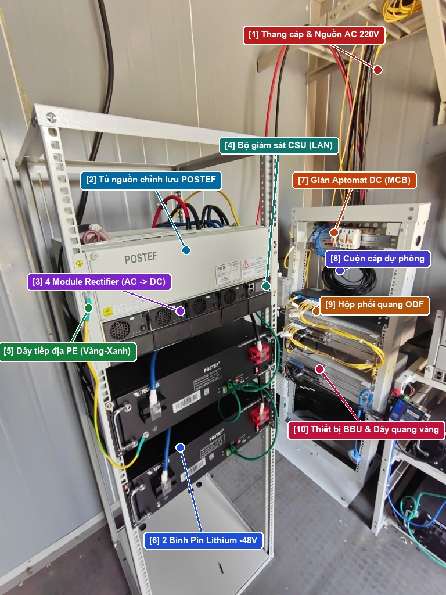
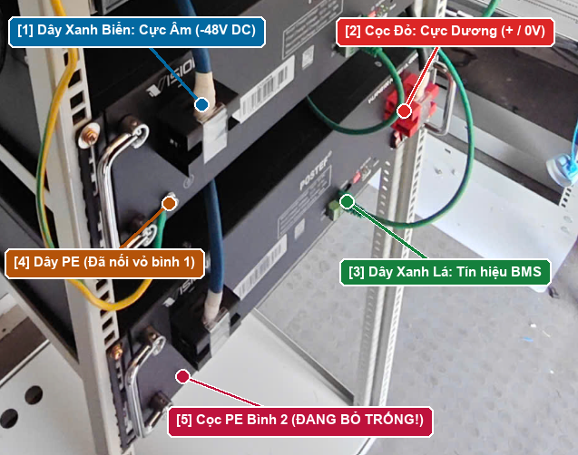

# Hệ thống Nguồn DC -48V, Pin Lithium và Tủ Thiết bị Trạm Viễn thông (BTS)

Tài liệu này tổng hợp chi tiết cấu trúc phần cứng, nguyên lý cấp nguồn **AC/DC**, hệ thống dây dẫn (động lực, tín hiệu BMS, tiếp địa an toàn PE) và chức năng từng thành phần bên trong phòng máy trạm phát sóng viễn thông (**BTS / eNodeB / gNodeB**).

---

## 1. Sơ đồ nhận diện tổng thể phòng máy (Visual Overview)



### Bảng tra cứu nhanh 10 thành phần trên hình

| Ký hiệu | Tên thành phần | Khu vực | Chức năng cốt lõi |
| :---: | :--- | :--- | :--- |
| **`[1]`** | **Thang máng cáp & Cáp nguồn AC 220V** | Trên trần (Góc phải) | Nâng đỡ toàn bộ cáp điện, cáp quang và dây tiếp địa đi trên cao; dẫn nguồn điện lưới 220V AC từ tủ điện tổng vào trạm. |
| **`[2]`** | **Tủ nguồn chỉnh lưu POSTEF** | Tủ trái (Trên cùng) | Trung tâm biến đổi và phân phối nguồn điện một chiều **DC -48V** nuôi toàn bộ trạm và sạc cho hệ thống pin. |
| **`[3]`** | **4 Module Rectifier (Khối chỉnh lưu)** | Tủ trái (Dưới chữ POSTEF) | Các hộp có quạt tản nhiệt tròn làm nhiệm vụ biến đổi trực tiếp dòng điện xoay chiều **220V AC $\rightarrow$ -48V DC**. |
| **`[4]`** | **Bộ điều khiển giám sát CSU** | Tủ trái (Góc phải hàng quạt) | Bộ não của tủ nguồn: thu thập dữ liệu, điều chỉnh dòng sạc và gửi cảnh báo từ xa về trung tâm mạng (NOC) qua cổng LAN. |
| **`[5]`** | **Dây tiếp địa bảo vệ PE (Vàng - Xanh)** | Dọc sườn trái tủ & vỏ pin | Dẫn dòng điện rò và xung sét từ vỏ kim loại thiết bị chạy lên máng cáp trần, thoát ra bãi cọc đồng dưới lòng đất. |
| **`[6]`** | **2 Khối Pin lưu điện Lithium (-48V)** | Tủ trái (Ở giữa) | Pin **LiFePO4** chuẩn rack 19 inch (POSTEF / VISION), lưu trữ năng lượng DC để cấp điện tức thời khi mất điện lưới. |
| **`[7]`** | **Giàn Aptomat DC (MCB trên DIN-Rail)** | Tủ phải (Trên cùng) | Đóng/ngắt nguồn DC độc lập và bảo vệ quá tải, ngắn mạch riêng cho từng thiết bị mạng bên dưới. |
| **`[8]`** | **Cuộn cáp dự phòng (Service Loop)** | Tủ phải (Dưới Aptomat) | Cuộn dây cáp dự trữ (3 – 5m) phục vụ bảo trì, bấm lại đầu nối hoặc di dời tủ mà không phải kéo lại cáp từ ngoài trời. |
| **`[9]`** | **Hộp phối quang ODF** | Tủ phải (Khay đen 1U) | Điểm tập kết và hàn nối cáp quang cứng từ ngoài đường vào các cổng Adapter trong nhà trạm. |
| **`[10]`** | **Thiết bị BBU & Dây nhảy quang vàng** | Tủ phải (Ở giữa) | Xử lý tín hiệu băng tần di động (3G/4G/5G) và truyền dẫn dữ liệu bằng tia laser qua sợi cáp quang thủy tinh. |

---

## 2. Bản chất dòng điện AC vs. DC và Lý do Viễn thông dùng DC -48V

### 2.1. Phân biệt nhanh AC và DC

| Tiêu chí | Điện AC (Alternating Current)<br>**Dòng điện Xoay chiều** | Điện DC (Direct Current)<br>**Dòng điện Một chiều** |
| :--- | :--- | :--- |
| **Hình ảnh trực quan** | Giống **sóng biển dập dềnh** tới lui liên tục (đổi chiều 50 lần/giây - tần số $50\text{ Hz}$). | Giống **dòng sông chảy thẳng** một hướng duy nhất, phẳng lì (tần số $0\text{ Hz}$). |
| **Cực tính** | Không cố định âm/dương (chỉ có **Dây Lửa - L** và **Dây Nguội - N**). Cắm phích chiều nào cũng chạy. | Phân biệt cố định **Cực Dương (+)** và **Cực Âm (-)**. Cắm ngược cực sẽ gây chập nổ. |
| **Điểm mạnh nhất** | Dễ tăng/hạ áp bằng máy biến áp để **truyền tải đi xa hàng trăm km** trên đường dây điện lực ít hao hụt. | **Lưu trữ được vào Pin/Ắc quy** và **nuôi sống các con chip bán dẫn** hoạt động bằng logic `0` và `1`. |
| **Ứng dụng tại trạm** | Đường điện kéo từ cột EVN vào trạm, chạy máy điều hòa phòng máy, đèn chiếu sáng. | Lưu trữ trong 2 khối Pin Lithium, cấp nguồn chạy các hộp máy phát sóng BBU, Router, ODF. |

### 2.2. Tại sao Viễn thông bắt buộc dùng chuẩn **DC -48V** (mà không dùng AC 220V)?

1. **Chuyển nguồn dự phòng "0 giây" (Zero Transfer Time):**
   * Nếu thiết bị chạy AC 220V: Khi cúp điện, phải mất $5 \sim 10\text{ ms}$ để bộ nghịch lưu (Inverter) biến điện DC từ pin thành AC và đóng rơ-le chuyển mạch $\rightarrow$ Thiết bị viễn thông sẽ bị chớp tắt, sập nguồn và mất 15 phút khởi động lại (rớt toàn bộ cuộc gọi).
   * Khi dùng DC -48V: Đầu ra của tủ nguồn POSTEF và 2 khối Pin Lithium được đấu chung trực tiếp vào một **Thanh cái DC (DC Busbar)**. Khi mất điện lưới, dòng điện từ Pin tự động tràn ra nuôi máy ngay lập tức theo nguyên lý bình thông nhau (**độ trễ = 0 giây tuyệt đối**).
2. **Không gây nhiễu sóng (Clean Power):**
   * Điện AC đổi chiều 50 lần/giây tạo ra từ trường biến thiên gây tiếng ù (*50Hz Hum*) và nhiễu sóng vô tuyến. Điện DC phẳng lì một chiều giúp tín hiệu thoại và dữ liệu 4G/5G trong sạch tuyệt đối.
3. **Tại sao chọn con số 48V (mà không phải 12V hay 220V)?**
   * **So với 12V:** Cùng một công suất ($P = U \times I$), dùng 48V giúp giảm dòng điện ($I$) xuống 4 lần so với 12V. Nhờ đó dây đồng chỉ cần to cỡ ngón tay thay vì phải to bằng cổ tay, giảm chi phí đồng và không bị nóng dây.
   * **So với 110V/220V:** Theo chuẩn an toàn quốc tế (IEC), ngưỡng điện áp một chiều an toàn cho con người là **dưới 60V DC**. Mức 48V (khi sạc đầy khoảng 54V – 56V) đảm bảo kỹ thuật viên lỡ chạm tay vào cọc điện trần cũng **không bị điện giật nguy hiểm tính mạng**.
4. **Bí mật của dấu trừ (-48V) — Chống ăn mòn điện hóa:**
   * Hệ thống viễn thông đem **Cực Dương (+) nối thẳng xuống đất (gọi là 0V)**, còn dây dẫn mang **Cực Âm (-48V)**.
   * Nếu dùng điện áp dương (+48V), hiện tượng điện phân trong môi trường ẩm ướt sẽ đẩy các ion đồng ra ngoài làm dây cáp và mối nối nhanh chóng bị **oxy hóa mục nát, sủi bọt xanh**. Dùng điện áp âm (-48V) tạo hiệu ứng *Bảo vệ Cathode*, hút chặt các ion kim loại vào lõi dây giúp thiết bị bền bỉ hàng chục năm.

---

## 3. Chu trình dòng điện và Giải phẫu Tủ Nguồn & Pin (Rack bên trái)

### 3.1. Sơ đồ hành trình dòng điện vào trạm

```text
[ Cột điện lực EVN ngoài đường (220V AC) ]
                    │
                    ▼
[ Công tơ điện & Tủ điện AC tổng (kèm chống sét AC) ]
                    │ (Dây cáp to Đỏ/Đen đi trên thang cáp trần nhà [1])
                    ▼
┌───────────────────────────────────────────────────────────────────┐
│ TỦ NGUỒN POSTEF [2]                                               │
│  1. Qua Aptomat AC & Bộ cắt lọc sét nội bộ                        │
│  2. Đi vào 4 Module Rectifier (4 hộp quạt tròn) [3]               │
│     ══> BIẾN ĐỔI: 220V AC ───> -48V DC                            │
│  3. Đổ chung vào Thanh cái đồng trung tâm (DC Busbar)             │
└───────────────────┬───────────────────────────────────────────────┘
                    │
      ┌─────────────┴─────────────────────────────┐
      ▼ (Nhánh 1: Nạp/Xả qua dây Xanh/Đỏ)         ▼ (Nhánh 2: Cấp tải liên tục)
┌───────────────────────────┐               ┌───────────────────────────┐
│ 2 BÌNH PIN LITHIUM [6]    │               │ TỦ THIẾT BỊ BÊN PHẢI      │
│ • Có điện lưới: Sạc vào   │               │ • Qua giàn Aptomat [7]    │
│ • Mất điện lưới: Xả ngược │               │ • Nuôi thiết bị BBU [10]  │
│   lên Thanh cái (0ms trễ) │               │   phát sóng 4G/5G         │
└───────────────────────────┘               └───────────────────────────┘
```

> [!TIP]
> **Tính năng Dự phòng (N+1) và Cắm nóng (Hot-swap) của 4 hộp quạt Rectifier `[3]`:**
> * Thay vì làm 1 bộ đổi nguồn khổng lồ (hỏng là chết cả trạm), người ta chia nhỏ thành **4 module độc lập**. Nếu trạm chỉ cần 3 hộp để chạy đủ tải, hộp thứ 4 đóng vai trò dự phòng.
> * Khi 1 hộp cháy hỏng, kỹ thuật viên chỉ cần gạt lẫy rút hộp hỏng ra và đút hộp mới vào (**Hot-swap**) ngay khi trạm đang chạy mà không cần tắt nguồn.

---

### 3.2. Giải phẫu chi tiết các loại dây trên Khối Pin Lithium



#### 1. Cặp dây nguồn động lực: Dây Xanh Biển `[1]` & Cọc Đỏ `[2]` ("Mạch máu")
* **Đặc điểm:** Dây đồng tiết diện lớn ($25 \sim 35\text{ mm}^2$), chịu dòng tải cực lớn ($50\text{A} \sim 100\text{A}$). Có nắp nhựa mica trong suốt và nắp chụp đỏ che chắn chống va quẹt gây chập điện.
* **Phân cực:** 
  * **Dây Xanh Biển `[1]`:** Cực Âm (**-48V DC**).
  * **Cọc Đỏ `[2]`:** Cực Dương (**+ / 0V**).
* **Công dụng:** Tạo thành một mạch kín dẫn dòng điện lớn để **nạp điện** vào bình khi có điện lưới và **xả điện** ngược lên nuôi trạm khi mất điện.

#### 2. Dây cáp mạng nhỏ: Dây Xanh Lá Cây `[3]` ("Dây thần kinh BMS")
* **Đặc điểm:** Dây cáp mạng bấm đầu RJ45, kết nối theo chuẩn giao tiếp công nghiệp **RS485 hoặc CAN-bus**.
* **Cách đi dây:** Cắm nối tiếp (Cascade) từ bình trên xuống bình dưới, và 1 nhánh kéo thẳng lên bộ giám sát CSU `[4]` của tủ POSTEF.
* **Công dụng:**
  * Gửi thông số sống còn của từng cell pin lên tủ nguồn: Phần trăm dung lượng (**SOC**), độ chai pin (**SOH**), điện áp từng cell, nhiệt độ bình.
  * Giúp 2 bình "giao tiếp" để **chia tải đồng đều** khi xả và cân bằng dòng điện khi sạc.
* **Tình huống thực tế — Nếu tuột sợi dây xanh lá này thì sao?**
  * Trạm **KHÔNG bị sập nguồn ngay lập tức** (vì dòng điện năng vẫn chạy qua cặp dây to Xanh biển/Đỏ).
  * Tuy nhiên, tủ POSTEF sẽ bị "mù thông tin", lập tức hú còi cảnh báo lỗi *"BMS Communication Fail"* về trung tâm và chuyển về chế độ sạc áp cố định. Nếu để lâu ngày không cắm lại, pin sẽ không được điều tiết thông minh dẫn đến lệch cell hoặc phù pin.

#### 3. Cơ chế điều khiển 2 cấp giữa Pin và Tủ nguồn
* **Cấp 1 — Tự động 100% tại chỗ (Phản xạ tức thời):** Tủ nguồn POSTEF và mạch BMS tự động điều chỉnh dòng sạc (sạc nhanh khi đói, giảm dòng khi đạt 90%, tự ngắt khi đầy 100%), tự cắt rơ-le khi quá nhiệt ($>55^\circ\text{C}$) hoặc tự ngắt tải khi pin cạn kiệt (LVD) mà không cần đợi lệnh con người.
* **Cấp 2 — Báo cáo về cho Con người (Bác sĩ giám sát từ xa):** Thông số từ dây xanh lá được tủ POSTEF đẩy qua mạng internet về màn hình trung tâm (NOC). Con người dựa vào đó để điều động máy phát điện đi ứng cứu khi mất điện lâu, hoặc mang bình mới đến thay khi máy báo có cell pin bị hỏng.

---

## 4. Hệ thống Tiếp địa PE (Protective Earth) & Phân tích lỗi hiện trường

### 4.1. Bản chất và đường đi thực tế của dây PE (Vàng sọc Xanh)
* **Khái niệm:** **PE** (*Protective Earth*) là dây nối đất bảo vệ, được bắt ốc trực tiếp vào **vỏ kim loại** của thiết bị (không phải cực cấp điện).
* **Vì sao chỉ cần 1 dây bắt vào vỏ?** Vì vỏ sắt là một khối dẫn điện liền mạch và mục đích của dây PE là xả dòng điện rò một chiều xuống lòng đất (Trái Đất có điện thế $0\text{V}$ và điện trở bãi tiếp địa cực thấp $< 4\,\Omega$, nhỏ hơn hàng nghìn lần so với điện trở cơ thể người $\approx 2.000\,\Omega$).
* **Vì sao trong ảnh không thấy dây đâm xuống sàn nhà?**
  * Sàn phòng máy (container/shelter) là sàn kín cách nhiệt, chống ẩm và chuột bọ nên tuyệt đối không đục sàn.
  * Dây PE từ vỏ pin `[4]` $\rightarrow$ bò sang cột sắt trái $\rightarrow$ nối chung vào vỏ tủ POSTEF `[5]` $\rightarrow$ **chạy ngược lên giàn thang cáp trên trần nhà `[1]`** $\rightarrow$ đi men theo trần tới **Thanh đồng tiếp địa tổng** gắn trên vách tường $\rightarrow$ xuyên tường ra ngoài trời và nối vào **bãi cọc đồng dài 2.4m – 3m đóng sâu dưới lòng đất**.

### 4.2. Phát hiện lỗi thi công tại vị trí `[5]` trên ảnh chi tiết Pin

> [!WARNING]
> **Phân tích lỗi bỏ sót dây tiếp địa ở Bình Pin số 2 (Bình dưới):**
> Quan sát ảnh cận cảnh:
> * Tại **Vị trí `[4]` (Bình trên):** Cọc ốc tiếp địa (cạnh tay nắm inox, có biểu tượng nối đất $\frac{\perp}{\equiv}$) đã được bắt đầu cosse dây vàng-xanh chuẩn chỉnh.
> * Tại **Vị trí `[5]` (Bình dưới):** Đúng con ốc tiếp địa tương tự đang **BỊ BỎ TRỐNG HOÀN TOÀN** (thợ quên chưa bắt dây).

#### 3 Kịch bản sự cố nguy hiểm khi Bình 2 thiếu dây PE:
1. **Điện giật kỹ thuật viên:** Khung tủ rack và tai bình đều phủ **sơn tĩnh điện (chất cách điện)** nên các ốc bắt rack không thể thoát điện tốt. Nếu bình dưới bị rò điện ra vỏ sắt, kỹ thuật viên chạm tay vào tay nắm inox sẽ bị điện phóng qua người.
2. **Cháy nổ mạch BMS qua dây mạng xanh lá:** Khi vỏ bình 2 tích tụ tĩnh điện cao trong khi vỏ bình 1 bằng $0\text{V}$, dòng điện chênh áp sẽ tìm đường phóng qua các sợi đồng siêu nhỏ của **dây mạng BMS xanh lá `[3]`** nối giữa 2 bình $\rightarrow$ đánh thủng và làm nổ chip vi xử lý giao tiếp trên bo mạch pin.
3. **Sét lan truyền gây cháy nổ Pin Lithium:** Khi sét đánh gần cột anten ngoài trời, dòng cảm ứng sét cực lớn không thoát được khỏi vỏ bình 2 sẽ đánh xuyên lớp cách điện vào cell pin bên trong, gây hiện tượng thoát nhiệt (*Thermal Runaway* $>800^\circ\text{C}$) thiêu rụi trạm.

* **Cách khắc phục:** Bổ sung ngay một đoạn dây đồng vàng-xanh ($\ge 6\text{ mm}^2$) bấm 2 đầu cosse tròn, nối bắc cầu từ cọc tiếp địa `[4]` của bình trên xuống cọc tiếp địa `[5]` của bình dưới.

---

## 5. Chi tiết các thành phần Tủ Thiết bị Mạng & Truyền dẫn (Rack bên phải)

1. **Giàn Aptomat DC — MCB (`[7]`):**
   * Nhận nguồn DC -48V từ tủ POSTEF bên trái sang và chia nhỏ cho từng máy.
   * Nếu một máy bên dưới bị chập điện, chỉ riêng Aptomat của máy đó nhảy cắt nguồn, các thiết bị còn lại vẫn hoạt động bình thường. Giúp thợ bật/tắt từng thiết bị độc lập khi bảo trì.
2. **Cuộn cáp dự phòng — Service Loop (`[8]`):**
   * Giữ lại một đoạn dây dài quấn tròn gọn gàng để khi cần di dời vị trí tủ hoặc khi đầu cắm quang/nguồn bị gãy hỏng, kỹ thuật viên chỉ việc nhả dây ra bấm lại đầu mới mà không phải kéo lại cả tuyến cáp dài từ ngoài đường vào.
3. **Hộp phối quang ODF — Optical Distribution Frame (`[9]`):**
   * Cáp quang kéo từ ngoài đường vào là cáp cứng nhiều lõi. Bên trong hộp ODF đen này, các sợi thủy tinh được hàn nhiệt nối vào các đầu cắm chuẩn (Adapter) để bảo vệ mối hàn khỏi đứt gãy.
4. **Dây nhảy quang vàng & Module SFP (`[10]`):**
   * **Dây màu vàng:** Quy ước quốc tế của **Cáp quang Single-mode (Đơn mốt)** có lõi thủy tinh siêu tinh khiết ($9\,\mu\text{m}$).
   * **Thứ chạy bên trong dây vàng:** Không phải dòng điện, mà là **Ánh sáng (Tia Laser)** truyền dữ liệu với tốc độ xấp xỉ $300.000\text{ km/s}$.
   * **Module SFP:** Các thỏi kim loại nhỏ cắm vào cổng máy BBU, làm nhiệm vụ biến đổi tín hiệu điện từ bo mạch thành tia sáng laser bắn vào dây vàng (và ngược lại).
5. **Thiết bị xử lý băng tần BBU — Baseband Unit (`[10]`):**
   * Là "bộ não" xử lý toàn bộ cuộc gọi, tin nhắn và dữ liệu 4G/5G của trạm phát sóng.
   * Kết nối với khối vô tuyến **RRU / AAU** trên đỉnh cột ăng-ten thông qua chính các sợi cáp quang màu vàng này.
