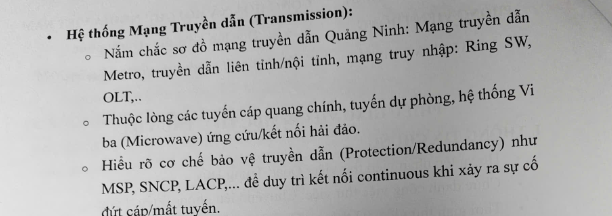
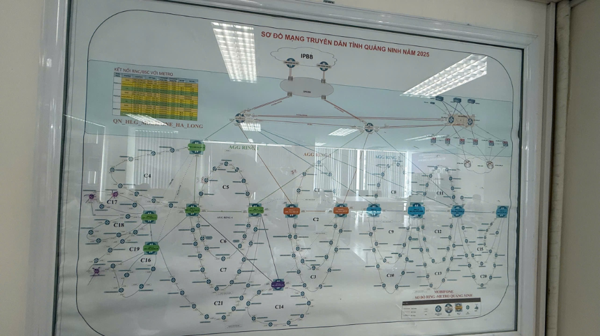

# Hệ thống Mạng Truyền dẫn Quảng Ninh (Transmission) & Cơ chế Bảo vệ Mạng
*(Tài liệu tổng hợp liên kết trực tiếp giữa **Lý thuyết Phiếu giao việc** và **Sơ đồ thực tế Mạng Truyền dẫn MobiFone Quảng Ninh năm 2025**)*

---

## 0. Hình ảnh Thực tế: Phiếu Giao Việc & Sơ Đồ Truyền Dẫn Quảng Ninh 2025





> [!IMPORTANT]
> **Tư duy cốt lõi cho người mới:**
> Mạng truyền dẫn (Transmission) giống như **hệ thống giao thông đường bộ** chuyên chở dữ liệu (cuộc gọi, internet 4G/5G, cáp quang). Mọi ký hiệu trên tấm bảng **Sơ đồ mạng truyền dẫn tỉnh Quảng Ninh năm 2025** đều được vẽ ra để giải quyết đúng **3 gạch đầu dòng** trong phiếu giao việc của bạn.

---

## 1. YÊU CẦU 1: Nắm chắc sơ đồ mạng truyền dẫn Quảng Ninh
> **Đề bài:** *"Nắm chắc sơ đồ mạng truyền dẫn Quảng Ninh: Mạng truyền dẫn Metro, truyền dẫn liên tỉnh/nội tỉnh, mạng truy nhập: Ring SW, OLT,.."*

### 1.1. Sơ đồ phân cấp 3 tầng (Từ Đỉnh bảng xuống Đáy bảng)
Nhìn tấm bảng trên tường theo chiều **từ TRÊN xuống DƯỚI**, mạng truyền dẫn Quảng Ninh được chia làm **3 tầng phân cấp** rõ rệt:

```text
[TẦNG 1: TRUYỀN DẪN LIÊN TỈNH - ĐỈNH BẢNG (Đường cao tốc Quốc gia)]
   Đám mây IPBB (Mạng đường trục IP Quốc gia) <===> Hệ thống DWDM (Ghép bước sóng quang liên tỉnh)
                                   ║
                    (2 Nhánh cáp quang bó luồng LACP)
                                   ▼
[TẦNG 2: MẠNG METRO & TRUYỀN DẪN NỘI TỈNH - GIỮA BẢNG (Quốc lộ / Tỉnh lộ)]
   ┌───────────────────────────────┴───────────────────────────────┐
   ▼                                                               ▼
[Core Router Hạ Long 1]  <════(Bó luồng LACP)════>  [Core Router Hạ Long 2]
   ├── Góc trên trái: Bảng KẾT NỐI RNC/BSC VỚI METRO (Tổng đài 2G/3G tại Hạ Long)
   └── Góc trên phải: Cụm OLT / Thiết bị dịch vụ băng rộng & nội hạt Hạ Long
   │
   ├──► Cụm AGG RING 1 & 4 (5 Ô Vuông Xanh Lá - Trái): Cánh Miền Tây Quảng Ninh
   ├──► Cụm AGG RING 3     (2 Ô Vuông Cam - Giữa)    : Khu vực Trung tâm TP. Hạ Long
   ├──► Cụm AGG RING 2     (4 Ô Vuông Xanh Dương-Phải): Cánh Miền Đông Quảng Ninh
   └──► Cụm Node AGG Tím   (1 Ô Vuông Tím - Dưới)    : Nhánh gom mở rộng phía dưới
                                   ║
              (Đấu nối kép Dual-Homing xuống từng vòng Ring SW)
                                   ▼
[TẦNG 3: MẠNG TRUY NHẬP (ACCESS NETWORK) - NỬA DƯỚI BẢNG (Đường xã/phường)]
   • Cụm Xanh lá gánh 9 vòng Ring SW : C4, C5, C6, C7, C16, C17, C18, C19, C21
   • Cụm Cam gánh 3 vòng Ring SW     : C1, C2, C3
   • Cụm Tím gánh 1 vòng Ring SW     : C14
   • Cụm Xanh dương gánh 8 vòng Ring : C8, C9, C10, C11, C12, C13, C15, C20
   (Tổng cộng: 21 vòng Ring SW từ C1 -> C21 gom toàn bộ các trạm phát sóng BTS/eNodeB/gNodeB)
```

### 1.2. Bảng đối chiếu trực tiếp: Lý thuyết $\leftrightarrow$ Thực tế trên Bảng Kính

| Khái niệm trong Phiếu giao việc | Giải thích bản chất (Cho người mới) | Vị trí tương ứng trên Sơ đồ Bảng Kính (MobiFone Quảng Ninh) |
| :--- | :--- | :--- |
| **Truyền dẫn Liên tỉnh** | Là "đường cao tốc" nối mạng tỉnh Quảng Ninh đi Hải Phòng, Hà Nội và Quốc tế. Dung lượng siêu lớn (hàng trăm Gbps). | Nằm ở **Đỉnh bảng**:<br>• Đám mây **`IPBB`** (*IP Backbone* - Đường trục IP quốc gia).<br>• Hình bầu dục màu xám **`DWDM`** (Truyền dẫn quang đường trục ghép bước sóng). |
| **Mạng truyền dẫn Metro & Nội tỉnh** | Là mạng đô thị/nội tỉnh, đóng vai trò như "Quốc lộ" kết nối Trung tâm Tỉnh (TP. Hạ Long) đi tới trung tâm các huyện, thị xã, thành phố trong tỉnh Quảng Ninh. | Nằm ở **Tầng Giữa bảng**, gồm 2 lớp:<br>1. **Lớp Lõi tỉnh (Core Metro):** 2 thiết bị Router tròn lớn đặt tại trung tâm Hạ Long (`QN_HLG_MOBIFONE_HA_LONG`), nằm ngay dưới `DWDM`.<br>2. **Lớp Gom nội tỉnh (`AGG RING`):** Hàng ngang gồm các **ô vuông lớn tô màu** kết nối các huyện/thị xã:<br>• **`AGG RING 3` (2 ô Cam - Giữa):** Khu vực trung tâm Hạ Long.<br>• **`AGG RING 1 & 4` (5 ô Xanh lá - Trái):** Nhánh miền Tây (Bãi Cháy, Quảng Yên, Uông Bí, Đông Triều...).<br>• **`AGG RING 2` (4 ô Xanh dương - Phải):** Nhánh miền Đông (Cẩm Phả, Vân Đồn, Tiên Yên, Móng Cái...).<br>• **1 ô Tím (Dưới giữa):** Điểm gom mở rộng nối vào cụm Xanh lá. |
| **Ring SW (Vòng Switch Truy nhập)** | Các thiết bị Switch đặt tại các trạm phát sóng (BTS 3G/4G/5G) ở xã/phường được nối với nhau thành **vòng tròn khép kín (Ring)** rồi đấu về các ô vuông AGG. | Nằm ở **Nửa dưới bảng**:<br>• Chính là **21 vòng bầu dục ký hiệu từ `C1` đến `C21`**.<br>• Mỗi chấm tròn nhỏ trên vòng `C` là **1 trạm phát sóng/điểm truy nhập**.<br>• Phân bổ: Cụm Cam gánh **3 vòng** (`C1–C3`), Cụm Xanh lá gánh **9 vòng** (`C4–C7`, `C16–C19`, `C21`), Cụm Tím gánh **1 vòng** (`C14`), Cụm Xanh dương gánh **8 vòng** (`C8–C13`, `C15`, `C20`). |
| **OLT & Thiết bị kết nối dịch vụ** | • **OLT:** Thiết bị quang trung tâm đặt tại trạm để kéo cáp quang về Modem Wi-Fi (ONT) nhà khách hàng.<br>• **BSC/RNC:** Bộ điều khiển trạm phát sóng di động 2G (BSC) và 3G (RNC). | Nằm ở **2 góc phía trên của bảng**:<br>• **Góc trên bên phải:** Cụm thiết bị nội hạt, Switch dịch vụ, OLT đấu nối vào mạng Metro.<br>• **Góc trên bên trái:** Bảng **`KẾT NỐI RNC/BSC VỚI METRO`** ghi chi tiết cổng đấu nối tổng đài di động 2G/3G tại Hạ Long vào thiết bị Metro. |

---

## 2. YÊU CẦU 2: Thuộc lòng cáp quang chính, dự phòng & Vi ba
> **Đề bài:** *"Thuộc lòng các tuyến cáp quang chính, tuyến dự phòng, hệ thống Vi ba (Microwave) ứng cứu/kết nối hải đảo."*

### 2.1. Nguyên tắc Tuyến cáp quang chính (Working) & Tuyến dự phòng (Protection)
* **Bản chất:** Cáp quang ngoài thực địa rất dễ đứt (do làm đường, sạt lở, bão lũ). Do đó, không bao giờ được nối các trạm quan trọng bằng 1 đường cáp độc đạo, mà phải đi **2 hướng cáp khác nhau** (khép thành vòng Ring).
* **Liên hệ trực tiếp trên Sơ đồ Bảng Kính:**
  1. **Trên tầng Liên tỉnh (`DWDM` $\leftrightarrow$ `Core`):** Có **2 nhánh cáp màu đỏ tách biệt** đi về 2 con Core Hạ Long, cộng thêm đường cáp nối ngang giữa 2 con Core. Đứt nhánh bên trái thì lưu lượng lập tức đi vòng qua nhánh bên phải.
  2. **Trên tầng Nội tỉnh (`AGG RING 1, 2, 3, 4`):** Giữa các ô vuông màu Xanh lá, Cam, Xanh dương luôn có **2 đường kết nối tạo thành vòng khép kín** (ví dụ: Tuyến cáp chính đi dọc Quốc lộ 18, tuyến cáp dự phòng đi dọc Cao tốc Hạ Long – Vân Đồn – Móng Cái hoặc đi vòng qua nhánh huyện khác).
  3. **Trên tầng Truy nhập (`C1` $\rightarrow$ `C21`):** Toàn bộ 21 nhánh trạm đều được khép thành **vòng tròn (`Ring`)**. Mỗi trạm nhỏ trên vòng `C` đều có 2 hướng đường đi: nếu đứt cáp bên trái, dữ liệu tự động chảy ngược về phía bên phải để lên thiết bị AGG.

### 2.2. Hệ thống Vi ba (Microwave) ứng cứu / kết nối hải đảo
* **Bản chất:** Là truyền dẫn **không dây** bằng sóng vô tuyến tần số rất cao (sóng cực ngắn GHz) giữa **2 chảo ăng-ten tròn nhìn thấy nhau (LOS - Line of Sight)** trên cột cao.
* **Vai trò đặc biệt tại Quảng Ninh:**
  1. **Kết nối Hải đảo:** Quảng Ninh có nhiều đảo (Cô Tô, Quan Lạn, Minh Châu, Ngọc Vừng, Thắng Lợi, Cái Chiên, Đảo Trần...). Kéo cáp biển rất đắt và dễ bị neo tàu làm đứt, nên **bắn sóng Vi ba vượt biển** từ đất liền (Vân Đồn, Cẩm Phả, Hải Hà...) ra đảo là mạch máu chính hoặc dự phòng chiến lược.
  2. **Ứng cứu thông tin (Đồi núi / Bão lũ):** Ở các huyện miền núi (Bình Liêu, Ba Chẽ...) hoặc khi có siêu bão làm đổ cột đứt cáp quang, Vi ba giúp duy trì sóng di động.
* **Liên hệ trên Sơ đồ Bảng Kính:**
  * Nhìn vào **các đường kẻ nét đứt (dashed lines)** và các nhánh rẽ ở rìa sơ đồ (như khu vực ngoài cùng bên trái `C16–C19` hoặc cánh miền Đông `AGG RING 2` đi Vân Đồn, Cô Tô, Móng Cái). Các tuyến không thể khép vòng cáp quang vật lý hoặc đi ra hải đảo sẽ sử dụng truyền dẫn Vi ba hoặc kênh thuê/dự phòng logic (xem chi tiết tại ô **Chú giải - Legend** góc dưới bên phải bảng).

---

## 3. YÊU CẦU 3: Hiểu rõ cơ chế bảo vệ truyền dẫn (MSP, SNCP, LACP...)
> **Đề bài:** *"Hiểu rõ cơ chế bảo vệ truyền dẫn (Protection/Redundancy) như MSP, SNCP, LACP,... để duy trì kết nối continuous khi xảy ra sự cố đứt cáp/mất tuyến."*

### Tại sao đứt cáp mà mạng vẫn "Continuous" (Liên tục không rớt)?
Khi đứt cáp, các giao thức bảo vệ tự động chuyển luồng dữ liệu sang đường dự phòng trong thời gian **dưới 50 mili-giây ($< 50\text{ ms}$, tức chưa tới $1/20$ giây)**. Người dùng đang gọi điện thoại hay lướt 4G/5G sẽ không hề cảm nhận được sự cố.

Dưới đây là cách **4 cơ chế bảo vệ** xuất hiện ngay trên tấm bảng của bạn:

### 3.1. Giao thức `LACP` (Link Aggregation Control Protocol) – *Bó luồng / Gộp cổng*
* **Bản chất kỹ thuật:** Thay vì cắm 1 sợi cáp quang giữa 2 thiết bị Switch/Router/OLT, người ta cắm **2 đến 4 sợi cáp quang song song** rồi dùng giao thức **LACP** gộp chúng lại thành **1 đường ống logic duy nhất** (gọi là `Eth-Trunk` hoặc `Port-Channel`).
  * **Tác dụng 1 (Tăng tốc):** Gộp 2 cổng $10\text{ Gbps} \rightarrow$ thành đường truyền $20\text{ Gbps}$.
  * **Tác dụng 2 (Bảo vệ liên tục):** Đứt 1 sợi hoặc cháy 1 cổng quang, 100% lưu lượng tự động dồn sang sợi còn lại ngay lập tức mà không mất gói tin nào.
* **Nhìn thấy ở đâu trên Sơ đồ Bảng Kính?**
  * Hãy nhìn các đường kẻ màu đỏ nối từ `DWDM` xuống 2 Core, đường nối ngang giữa 2 Core, và đường nối giữa các ô vuông `AGG`: Bạn sẽ thấy **2 đường kẻ song song có một vòng tròn dẹt (hình elip) khoanh ngang qua**.
  * **Ký hiệu vòng elip khoanh qua nhiều sợi dây** chính là ký hiệu chuẩn của **Bó luồng LACP**!
  * Ngoài ra, trong bảng **`KẾT NỐI RNC/BSC VỚI METRO`** (góc trên bên trái), cột cổng kết nối sử dụng các nhóm `Eth-Trunk` chạy LACP để bảo vệ kết nối tổng đài 2G/3G.

```text
Minh họa ký hiệu LACP trên bảng kính:
[Thiết bị A] ═══(O)═══ [Thiết bị B]   <-- Vòng tròn (O) khoanh qua 2 sợi cáp = Bó luồng LACP
```

### 3.2. Cơ chế `MSP` (Multiplex Section Protection) – *Bảo vệ Điểm - Nối - Điểm (1+1 / 1:1)*
* **Bản chất kỹ thuật:** Dùng trên thiết bị truyền dẫn quang (SDH/OTN/DWDM) nối thẳng giữa 2 trạm A và B bằng 2 đường cáp (1 đường Chính - *Working*, 1 đường Dự phòng - *Protection*).
  * Với **MSP 1+1**: Đầu phát A nhân đôi tín hiệu truyền đồng thời trên cả 2 đường. Đầu thu B chọn nghe đường Chính; khi đường Chính đứt, B lập tức gạt sang nghe đường Dự phòng trong **$< 50\text{ ms}$**.
* **Nhìn thấy ở đâu trên Sơ đồ Bảng Kính?**
  * Áp dụng tại tầng truyền dẫn quang đường trục **`DWDM`** (đỉnh bảng) và các tuyến truyền dẫn quang điểm-nối-điểm giữa các trạm trung tâm.

### 3.3. Cơ chế `SNCP` (Sub-Network Connection Protection) & Bảo vệ Vòng Ring
* **Bản chất kỹ thuật:** Là cơ chế bảo vệ chuyên dụng cho cấu trúc **Mạch Vòng (Ring)**:
  * Tín hiệu từ 1 trạm dưới huyện gửi về Tỉnh sẽ được **phát đi cả 2 chiều của vòng Ring** (chiều kim đồng hồ và ngược chiều kim đồng hồ).
  * Thiết bị thu ở đầu Tỉnh nhận cả 2 hướng và chọn hướng có tín hiệu tốt hơn. Khi một bên vòng Ring bị máy xúc đào đứt cáp, thiết bị thu lập tức lấy tín hiệu từ chiều ngược lại trong **$< 50\text{ ms}$**.
  * *(Lưu ý nâng cao: Trên thiết bị truyền dẫn quang SDH/OTN cơ chế vòng này gọi là **SNCP**; còn trên thiết bị Switch/Router IP Metro trên bảng kính, cơ chế bảo vệ vòng Ring tương đương là **ERPS - G.8032** hoặc **MPLS Fast Reroute - FRR**).*
* **Nhìn thấy ở đâu trên Sơ đồ Bảng Kính?**
  * Chính là toàn bộ các vòng tròn khép kín trên bảng: **4 vòng `AGG RING` (1, 2, 3, 4)** ở tầng giữa và **21 vòng truy nhập (`C1` $\rightarrow$ `C21`)** ở tầng dưới!

### 3.4. Cơ chế `Dual-Homing` (Đấu nối kép vào 2 thiết bị cha khác nhau)
* **Bản chất kỹ thuật:** Không bao giờ cắm cả 2 đầu của một vòng Ring truy nhập vào cùng 1 thiết bị gom (vì nếu thiết bị gom đó mất nguồn hoặc hỏng phần cứng thì cả vòng Ring bên dưới sẽ mất mạng).
* **Nhìn thấy ở đâu trên Sơ đồ Bảng Kính?**
  * Hãy nhìn chân của tất cả các vòng **`C1` đến `C21`**: Hai đầu của mỗi vòng `C` luôn được đấu tách ra **2 ô vuông AGG khác nhau** (ví dụ vòng `C1, C2, C3` có 1 chân bám vào ô Cam bên trái, 1 chân bám vào ô Cam bên phải).
  * Nhờ vậy, dù có **hỏng hẳn 1 ô vuông AGG**, toàn bộ các trạm phát sóng trong vòng `C` vẫn giữ được kết nối *continuous* thông qua thiết bị AGG thứ 2!

---

## 4. BẢNG TỔNG KẾT "ĐIỂM MƯỜI" KHI BÁO CÁO THỬ VIỆC

| Câu hỏi kiểm tra của Sếp | Câu trả lời chuẩn xác (Kết hợp Lý thuyết + Sơ đồ thực tế) |
| :--- | :--- |
| **"Em hãy chỉ trên bảng đâu là Liên tỉnh, đâu là Metro nội tỉnh, đâu là Truy nhập?"** | • **Liên tỉnh:** Là cụm `IPBB` và `DWDM` ở trên đỉnh bảng.<br>• **Metro / Nội tỉnh:** Là 2 con Core Hạ Long ở trên và hàng ngang các ô vuông màu ở giữa gồm `AGG RING 1, 2, 3, 4` đi qua các huyện/thị.<br>• **Truy nhập (Ring SW):** Là 21 vòng tròn từ `C1` đến `C21` ở nửa dưới bảng gom các trạm phát sóng, cùng cụm OLT/BSC/RNC ở 2 góc trên. |
| **"Tại sao các trạm dưới xã/huyện lại vẽ thành hình vòng tròn C1 -> C21 mà không nối thẳng?"** | Để tạo **tuyến chính và tuyến dự phòng** theo cấu trúc **Mạch Vòng (Ring)**, áp dụng các cơ chế bảo vệ vòng (như **SNCP / ERPS / MPLS**). Khi đứt cáp ở một phía của vòng `C`, lưu lượng tự động đảo chiều đi theo nửa vòng còn lại về thiết bị `AGG` trong thời gian cực ngắn mà không làm gián đoạn dịch vụ. |
| **"Ký hiệu 2 đường kẻ có vòng tròn nhỏ khoanh ngang ở giữa trên bảng là gì?"** | Đó là ký hiệu bó luồng **LACP (Eth-Trunk)**. Mình cắm nhiều sợi cáp quang song song giữa 2 thiết bị rồi gộp lại thành 1 cổng logic để vừa **cộng gộp băng thông**, vừa **dự phòng tự động** khi đứt 1 sợi cáp hoặc hỏng 1 module quang SFP. |
| **"Tại sao 2 chân của vòng C luôn cắm vào 2 ô vuông AGG khác nhau?"** | Đó là thiết kế dự phòng **Dual-Homing** (chống điểm lỗi đơn lẻ). Nếu 1 thiết bị AGG bị mất nguồn hoặc hỏng hoàn toàn, toàn bộ các trạm trong vòng `C` vẫn giữ được kết nối *continuous* thông qua thiết bị AGG thứ 2. |
