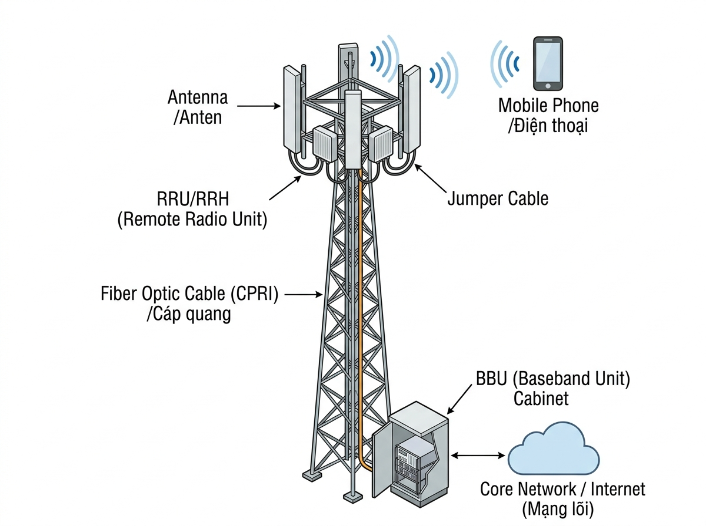
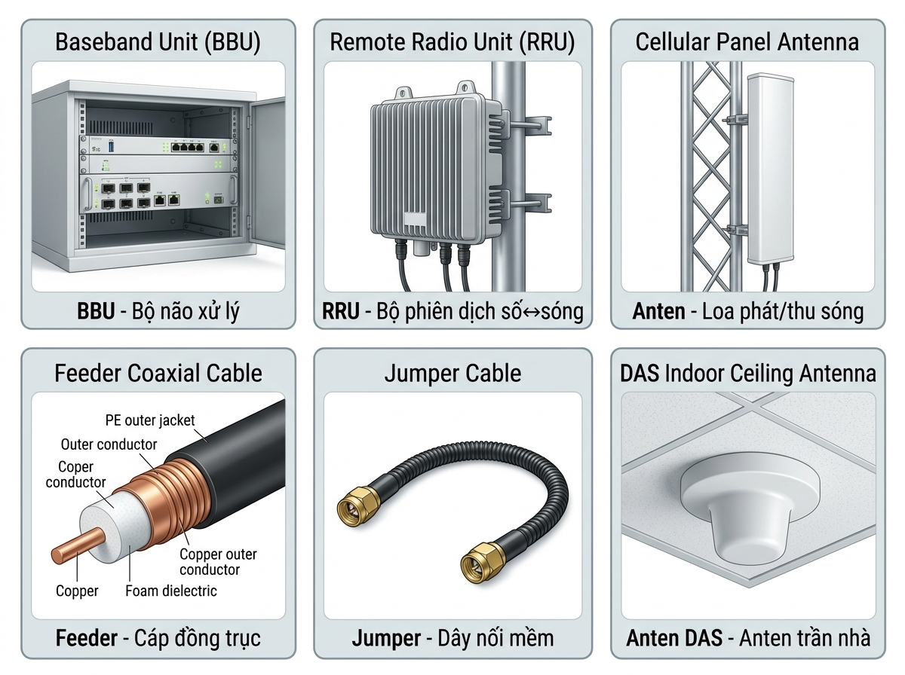
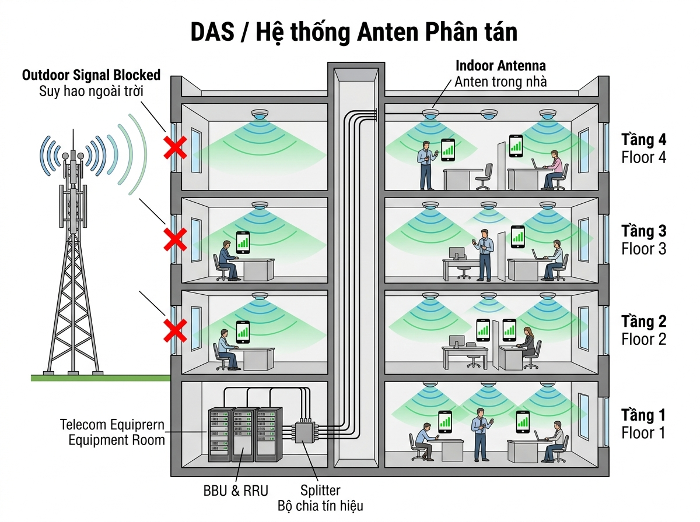

# 📡 GIẢI THÍCH CHI TIẾT: Thiết bị & Nguyên lý Vận hành Vô tuyến Viễn thông

> [!NOTE]
> Tài liệu này giải thích **từng thuật ngữ** trong mục 2.2 với **ảnh minh họa thực tế**, ví dụ đời thường, sơ đồ trực quan. Dành cho người mới hoàn toàn.

---

## 🗺️ PHẦN 1: TỔNG QUAN — Trạm viễn thông hoạt động thế nào?

### Hình dung đơn giản

Khi bạn **gọi điện, nhắn tin, lướt Facebook**, tín hiệu từ điện thoại bạn **không bay thẳng** tới người nhận. Nó phải đi qua một **trạm thu phát sóng** (cái cột anten mà bạn hay thấy trên nóc nhà hoặc ngoài đường).

### 🖼️ Sơ đồ tổng thể trạm viễn thông



**Luồng tín hiệu (cần nhớ thuộc lòng):**

```
📱 Điện thoại
    ↕ (sóng vô tuyến bay trong không khí)
📡 ANTEN (thu/phát sóng)
    ↕ (Jumper + Feeder — dây cáp ngắn)
📻 RRU (chuyển đổi: sóng ↔ tín hiệu số)
    ↕ (cáp quang — truyền bằng ánh sáng)
🖥️ BBU (xử lý dữ liệu)
    ↕ (cáp quang/truyền dẫn)
🌐 MẠNG LÕI → Internet → Người nhận
```

> **Ví dụ thực tế:** Bạn ở Quận 1, gọi cho bạn ở Quận 7. Giọng bạn → sóng → anten trạm Quận 1 → RRU → BBU → mạng lõi Viettel → BBU trạm Quận 7 → RRU → anten → sóng → điện thoại bạn kia.

### Tên gọi trạm theo từng thế hệ mạng

| Thế hệ mạng | Tên trạm | Ý nghĩa |
|---|---|---|
| 2G (GSM) | **BTS** | Base Transceiver Station – Trạm thu phát gốc |
| 3G (UMTS) | **NodeB** | Tên gọi trạm trong mạng 3G |
| 4G (LTE) | **eNodeB** | evolved NodeB – Trạm 4G |
| 5G (NR) | **gNodeB** | next-generation NodeB – Trạm 5G |

---

## 🗺️ PHẦN 2: CÁC THIẾT BỊ TẠI TRẠM (Chi tiết từng loại)

### 🖼️ Hình ảnh 6 loại thiết bị chính



---

### 1️⃣ BBU — Baseband Unit (Khối xử lý băng tần gốc)

#### BBU là gì?

BBU là **"bộ não"** của trạm viễn thông. Nó **xử lý toàn bộ dữ liệu số** — mã hóa, giải mã, sắp xếp, gửi/nhận dữ liệu giữa điện thoại và mạng Internet.

#### Hình dung thực tế

> 🏪 **Ví dụ:** Hãy tưởng tượng BBU giống **quầy thu ngân ở siêu thị**:
> - Khách hàng (dữ liệu từ điện thoại) xếp hàng tới quầy
> - Thu ngân (BBU) **quét mã, tính tiền, đóng gói** (xử lý dữ liệu)
> - Rồi gửi hàng ra kho (mạng Internet)
> - Và ngược lại: nhận hàng từ kho gửi cho khách

#### BBU trông như thế nào ngoài đời?

- Là **hộp kim loại hình chữ nhật**, kích thước khoảng **40×30×10cm** (bằng cái laptop lớn hơn)
- Có nhiều **cổng kết nối** (cổng quang, cổng mạng, cổng nguồn)
- Có **đèn LED** hiển thị trạng thái hoạt động
- Đặt trong **tủ thiết bị ngoài trời** (outdoor cabinet) ở chân cột anten, hoặc trong **phòng máy** (shelter)

#### Các dòng BBU phổ biến tại Việt Nam

| Hãng | Dòng sản phẩm | Đặc điểm | Ai dùng? |
|---|---|---|---|
| **Ericsson** 🇸🇪 | Baseband 6630, 6648 | Ổn định, phổ biến nhất | Viettel, VinaPhone |
| **Nokia** 🇫🇮 | AirScale ASIK, ASIA | Linh hoạt, tích hợp cao | MobiFone, một số mạng |
| **Huawei** 🇨🇳 | BBU3900, BBU5900 | Giá tốt, nhiều tính năng | Viettel, VinaPhone |

#### BBU làm những gì cụ thể?

1. **Điều chế / Giải điều chế (Modulation):** Chuyển dữ liệu thành dạng phù hợp để truyền qua sóng
2. **Mã hóa / Giải mã (Coding):** Thêm mã bảo vệ để dữ liệu không bị lỗi khi truyền
3. **Quản lý tài nguyên:** Phân chia băng tần cho từng điện thoại đang kết nối
4. **Xử lý Handover:** Quyết định khi nào chuyển điện thoại sang trạm khác

---

### 2️⃣ RRU / RRH — Remote Radio Unit / Head (Khối vô tuyến xa)

#### RRU là gì?

RRU là **"phiên dịch viên"** giữa BBU và Anten. Nó **chuyển đổi qua lại** giữa tín hiệu số (mà BBU hiểu) và sóng vô tuyến (mà điện thoại hiểu).

#### Hình dung thực tế

> 🌐 **Ví dụ:** Bạn là người Việt (BBU), muốn nói chuyện với người Nhật (điện thoại). Bạn cần **phiên dịch viên** (RRU):
> - Bạn nói tiếng Việt (tín hiệu số) → phiên dịch dịch sang tiếng Nhật (sóng vô tuyến) → người Nhật hiểu
> - Người Nhật nói tiếng Nhật (sóng vô tuyến) → phiên dịch dịch sang tiếng Việt (tín hiệu số) → bạn hiểu

#### RRU trông như thế nào ngoài đời?

- Hộp kim loại **chống nước**, kích thước khoảng **50×40×15cm**
- **Nặng 15-25kg**, có tay cầm để treo
- **Treo trên cột anten** (ở trên cao, gần anten) bằng giá đỡ (bracket)
- Có cổng quang (nối về BBU) và cổng RF (nối lên anten)

#### Tại sao RRU phải treo trên cao, gần anten?

> [!IMPORTANT]
> **Lý do quan trọng:** Sóng vô tuyến (RF) bị **hao hụt rất nhanh** khi truyền qua cáp đồng trục. Nếu RRU đặt ở chân cột (xa anten 30-50m), tín hiệu mất 40-60% trên đường đi!
>
> Giải pháp: Đặt RRU **ngay cạnh anten** → cáp RF rất ngắn → hao hụt gần bằng 0. Còn từ BBU lên RRU dùng **cáp quang** (hao hụt rất ít dù dài hàng km).

#### BBU nối với RRU bằng gì?

| Thành phần | Giải thích |
|---|---|
| **Cáp quang (Fiber Optic)** | Sợi thủy tinh mỏng truyền dữ liệu bằng **ánh sáng**, cực nhanh, hao hụt rất ít |
| **CPRI** | Giao thức (ngôn ngữ) mà BBU và RRU dùng để "nói chuyện" qua cáp quang. Dùng cho 4G |
| **eCPRI** | Phiên bản nâng cấp của CPRI, dùng cho **5G** |

---

### 3️⃣ ANTEN — Antenna (Anten thu/phát sóng)

#### Anten là gì?

Anten là thiết bị **phát sóng vô tuyến ra không gian** (downlink) và **thu sóng từ điện thoại** (uplink). Nó là thứ tiếp xúc trực tiếp với sóng điện từ.

#### Hình dung thực tế

> 📢 **Ví dụ 1:** Anten giống cái **loa phường** — phát âm thanh (sóng) ra cho mọi người xung quanh nghe. Đồng thời cũng là **micro** — thu giọng nói (sóng) từ điện thoại gửi lên.
>
> 🔦 **Ví dụ 2:** Anten giống **đèn pin**:
> - Đèn pin hẹp (beam hẹp) → chiếu **xa** nhưng vùng sáng **nhỏ**
> - Đèn pin rộng (beam rộng) → chiếu **gần** nhưng vùng sáng **lớn**
> - Anten cũng vậy: "tập trung" sóng hẹp thì phủ xa, rộng thì phủ gần

#### Anten trông như thế nào ngoài đời?

- Hình **chữ nhật dài** (panel antenna), cao khoảng **1m – 2.5m**, rộng 30cm
- Màu **trắng hoặc xám**
- Treo trên cột bằng **giá đỡ kim loại**
- Bạn thấy chúng **trên nóc nhà cao tầng, trên cột sắt ven đường**

#### Tại sao 1 trạm có 3 anten?

Mỗi anten chỉ phát sóng trong **1 hướng** (khoảng 65° - 120°). Để phủ **360° xung quanh**, cần **3 anten** quay 3 hướng, cách nhau 120°:

```
              Sector 1
            (hướng 0°/Bắc)
               📡
              ╱   ╲
            ╱  120° ╲
          ╱           ╲
    📡 ←─── 🗼 CỘT ───→ 📡
  Sector 3              Sector 2
(hướng 240°)         (hướng 120°)
```

> **Sector là gì?** Mỗi hướng phát sóng = 1 sector. Trạm 3 anten = **3 sector**. Bạn sẽ nghe kỹ sư nói "sector 1 của trạm ABC bị yếu" — nghĩa là hướng phát sóng thứ 1 có vấn đề.

#### Các thông số anten mà kỹ sư hay dùng

| Thông số | Giải thích đơn giản | Ví dụ thực tế |
|---|---|---|
| **Tần số (Frequency)** | Anten hoạt động ở dải tần nào | 700 MHz (phủ xa, xuyên tường tốt), 1800 MHz (phổ biến 4G), 2600 MHz (tốc độ cao nhưng phủ gần) |
| **Gain (Độ lợi)** | Khả năng "tập trung" sóng, tính bằng **dBi** | 15 dBi (bình thường), 18 dBi (xa hơn) — giống đèn pin: gain cao = chiếu xa |
| **Beamwidth (Độ rộng búp sóng)** | Góc phát sóng ngang | 65° (phổ biến), 90° (rộng hơn) |
| **Tilt (Góc nghiêng)** | Nghiêng anten xuống/lên | Nghiêng xuống 4° để sóng phủ gần trạm hơn, tránh nhiễu xa |
| **Azimuth (Hướng bắn)** | Anten quay mặt hướng nào (theo la bàn) | 0° = Bắc, 90° = Đông, 180° = Nam, 270° = Tây |
| **MIMO (số port)** | Dùng nhiều anten cùng lúc để tăng tốc | 2T2R = 2 phát 2 thu, 4T4R, 8T8R (càng nhiều = càng nhanh) |

> **Ví dụ thực tế về Tilt:**
> Trạm ở ngã tư Quận 1, xung quanh toàn nhà cao tầng. Nếu anten bắn thẳng ngang → sóng bay qua đầu nhà → vùng dưới chân trạm mất sóng. Giải pháp: **nghiêng anten xuống (tilt)** để sóng phủ đúng vùng cần thiết.

---

### 4️⃣ FEEDER — Cáp đồng trục (Coaxial Cable)

#### Feeder là gì?

Feeder là **sợi cáp** truyền tín hiệu **sóng vô tuyến (RF)** từ RRU đến anten và ngược lại.

#### Hình dung thực tế

> 🚿 **Ví dụ:** Feeder giống **ống nước** — nước (sóng RF) chảy từ máy bơm (RRU) qua ống (feeder) đến vòi sen (anten). Ống càng to → nước chảy càng mạnh, ít bị tắc (hao hụt ít).

#### Cấu tạo bên trong

```
Mặt cắt ngang Feeder:
    ╔══════════════╗
    ║  Vỏ ngoài    ║ ← Bảo vệ, chống nước
    ║ ╔══════════╗ ║
    ║ ║ Lớp đồng ║ ║ ← Chắn nhiễu bên ngoài (Shield)
    ║ ║ ╔══════╗ ║ ║
    ║ ║ ║ Cách  ║ ║ ║ ← Chất cách điện (Dielectric)
    ║ ║ ║ ● Lõi ║ ║ ║ ← Lõi đồng (truyền sóng RF)
    ║ ║ ╚══════╝ ║ ║
    ║ ╚══════════╝ ║
    ╚══════════════╝
```

#### Các loại Feeder

| Loại | Đường kính | Hao hụt | Khi nào dùng? |
|---|---|---|---|
| **1/2"** (nhỏ) | ~1.3cm | Nhiều hơn | Đoạn ngắn, trong nhà |
| **7/8"** (trung) | ~2.2cm | Trung bình | Phổ biến nhất, trạm outdoor |
| **1-5/8"** (lớn) | ~4.1cm | Ít nhất | Trạm cũ, khoảng cách xa |

> [!TIP]
> **Trạm hiện đại:** RRU đặt ngay cạnh anten → feeder rất ngắn hoặc **không cần** (chỉ cần jumper). Feeder dài chỉ còn thấy ở **trạm cũ** (BTS cũ đặt toàn bộ ở chân cột).

---

### 5️⃣ JUMPER — Dây nhảy (Dây nối mềm)

#### Jumper là gì?

Jumper là **đoạn cáp đồng trục ngắn, mềm** (0.5m – 3m) dùng để **nối** các thiết bị với nhau tại những điểm cần uốn cong.

#### Hình dung thực tế

> 🔌 **Ví dụ:** Giống dây sạc điện thoại — ngắn, mềm, hai đầu có đầu cắm. Jumper nối RRU với feeder, hoặc feeder với anten, ở những chỗ cáp cứng (feeder) không thể uốn được.

#### Tại sao cần Jumper mà không nối thẳng?

- Feeder **cứng**, khó uốn cong → không thể cắm thẳng vào cổng thiết bị
- Jumper **mềm**, dễ uốn → làm "khớp nối" linh hoạt
- Khi thay thiết bị, chỉ cần tháo jumper → nhanh, tiện

#### Sơ đồ kết nối thực tế

```
  📡 Anten
     │
  [Jumper 0.5m] ← mềm, uốn vào cổng anten
     │
  ═══════════ Feeder (cáp cứng, dài) ═══════════
     │
  [Jumper 1m] ← mềm, uốn vào cổng RRU
     │
  📻 RRU
```

---

### 6️⃣ DAS — Distributed Antenna System (Hệ thống anten phân tán)

#### DAS là gì?

DAS là hệ thống dùng **nhiều anten nhỏ** đặt rải rác bên trong tòa nhà để phủ sóng trong nhà.

#### Tại sao cần DAS?

> 🏢 **Vấn đề:** Sóng vô tuyến từ anten ngoài trời bị **tường bê tông, kính, sàn nhà chặn** rất mạnh. Vào trong:
> - Trung tâm thương mại (Vincom, Aeon Mall)
> - Sân bay (Tân Sơn Nhất, Nội Bài)
> - Bệnh viện, tòa nhà văn phòng
> - Hầm để xe, tầng hầm
>
> → Sóng **yếu hoặc mất hoàn toàn** → gọi điện bị ngắt, 4G chập chờn!

#### 🖼️ Sơ đồ DAS trong tòa nhà



#### Hình dung thực tế

> 💡 **Ví dụ:** Giống hệ thống **sprinkler chữa cháy** trong tòa nhà:
> - Nước (tín hiệu) từ bể chứa (BBU/RRU) → bơm qua ống (cáp) → ra nhiều đầu phun nhỏ (anten DAS) trên trần mỗi tầng
> - Mỗi đầu phun phủ 1 vùng nhỏ → tất cả đầu phun gộp lại phủ **toàn bộ tòa nhà**

#### Anten DAS trông như thế nào?

- Hình **tròn hoặc vuông nhỏ**, đường kính khoảng **15-20cm**
- Màu **trắng**, gắn trên **trần nhà**
- Bạn hay thấy trong Vincom, sân bay — những cái tròn trắng nhỏ trên trần đó!

---

## 🗺️ PHẦN 3: CÁC CHỈ SỐ KỸ THUẬT (KPI Vô tuyến)

Đây là các **con số đo lường chất lượng sóng**. Kỹ sư dùng chúng để biết vùng nào sóng tốt, vùng nào sóng xấu, cần sửa ở đâu.

### Ví dụ tổng quát

> 🎤 Hãy tưởng tượng bạn đang nghe bạn bè nói chuyện trong **quán cafe**:
>
> | Câu hỏi | Chỉ số tương ứng |
> |---|---|
> | Giọng bạn bè **to hay nhỏ**? | → **RSRP** |
> | Tổng âm thanh trong quán (giọng bạn + nhạc + tiếng người khác)? | → **RSSI** |
> | Nghe **rõ ràng** hay bị tiếng ồn lấn át? | → **RSRQ** |
> | Giọng bạn "nổi" hơn tiếng ồn **bao nhiêu lần**? | → **SINR** |

---

### 📶 RSRP — Reference Signal Received Power

#### Đây là gì?

**Đo mức tín hiệu mạnh/yếu** mà điện thoại nhận được từ trạm. Chỉ số **cơ bản nhất**, quan trọng nhất.

#### Đơn vị: dBm

- **dBm** = decibel-milliwatt = đơn vị đo **công suất**
- Giá trị luôn **âm** (vì công suất cực nhỏ, nhỏ hơn 1 milliwatt)
- **Gần 0 = mạnh**, **càng âm = càng yếu** (−60 > −100, nên −60 mạnh hơn −100)

#### Bảng tra RSRP

```
Đứng cạnh anten         Bình thường           Xa trạm            Rất xa / Hầm
    -60 dBm               -80 dBm             -100 dBm            -120 dBm
     |                      |                    |                    |
  ⬛⬛⬛⬛⬛              ⬛⬛⬛⬛              ⬛⬛                 ⬛
  5 vạch sóng           3-4 vạch             1-2 vạch            Mất sóng
```

| Mức | RSRP (dBm) | Bạn đang ở đâu? | Trải nghiệm |
|---|---|---|---|
| 🟢 Tuyệt vời | > −70 | Rất gần trạm | YouTube 4K mượt, gọi video HD |
| 🟢 Tốt | −70 đến −85 | Trong nhà gần trạm | Lướt web nhanh, gọi điện rõ |
| 🟡 Trung bình | −85 đến −100 | Xa trạm hoặc trong tòa nhà | Dùng được, đôi khi chậm |
| 🔴 Yếu | −100 đến −110 | Rất xa hoặc tầng hầm | Video hay buffer, gọi bị giật |
| ⚫ Mất sóng | < −110 | Vùng lõm, hầm sâu | Không kết nối được |

> **Ví dụ đời thực:** Bạn ở trong tòa nhà văn phòng Quận 3. Dùng app đo sóng thấy RSRP = **-95 dBm**. Tra bảng → 🟡 Trung bình → dùng được nhưng xem video có thể bị chậm. Nếu ra ban công (gần anten hơn), RSRP có thể tăng lên **-75 dBm** → 🟢 Tốt.

---

### 📊 RSRQ — Reference Signal Received Quality

#### Đây là gì?

**Đo chất lượng** tín hiệu — tức là tín hiệu hữu ích chiếm bao nhiêu phần trong tổng năng lượng nhận được.

#### Tại sao cần RSRQ khi đã có RSRP?

> 🔊 **Ví dụ:** Bạn đứng giữa **2 trạm** phát cùng tần số:
> - Trạm A (đang kết nối): RSRP = −80 dBm → tín hiệu khá mạnh ✅
> - Nhưng trạm B (bên cạnh) cũng phát mạnh → **nhiễu** vào tín hiệu trạm A
> - Kết quả: RSRP tốt nhưng **RSRQ xấu** → chất lượng kém, hay bị lỗi dữ liệu
>
> Giống như bạn nghe nhạc bằng loa to (RSRP tốt), nhưng bên cạnh có **cái loa khác cũng to** → hai tiếng trộn lẫn → nghe không rõ (RSRQ xấu).

#### Công thức (đơn giản)

$$\text{RSRQ} = N \times \frac{\text{RSRP}}{\text{RSSI}}$$

Trong đó **N** = số resource block (khối tài nguyên). Bạn chưa cần nhớ công thức, chỉ cần hiểu: **RSRQ = RSRP so với tổng nhiễu**.

#### Bảng tra RSRQ

| Mức | RSRQ (dB) | Ý nghĩa |
|---|---|---|
| 🟢 Tốt | > −10 | Ít nhiễu, tín hiệu sạch |
| 🟡 Trung bình | −10 đến −15 | Có nhiễu nhưng chấp nhận được |
| 🔴 Xấu | < −15 | Nhiễu nhiều, dữ liệu hay bị lỗi phải gửi lại |

---

### 📈 SINR — Signal to Interference plus Noise Ratio

#### Đây là gì?

**Tỷ lệ** giữa tín hiệu hữu ích và (nhiễu + tạp âm). Đây là chỉ số **quyết định tốc độ data** — SINR càng cao, download càng nhanh.

#### Hình dung thực tế

> 🗣️ **Ví dụ cực hay:** Bạn đang **họp Zoom** trong phòng:
>
> | Tình huống | SINR | Kết quả |
> |---|---|---|
> | Phòng cách âm, rất yên tĩnh | **30 dB** | Nghe rõ 100%, họp mượt mà |
> | Có máy lạnh chạy hơi ồn | **15 dB** | Nghe được, thỉnh thoảng hỏi lại |
> | Công trình khoan đường bên cạnh | **3 dB** | Nghe rất khó, hay bị ngắt quãng |
> | Đứng giữa chợ đông | **-5 dB** | Không nghe được gì, phải tắt Zoom |

#### Bảng tra SINR

| Mức | SINR (dB) | Tốc độ thực tế (4G LTE) | Trải nghiệm |
|---|---|---|---|
| 🟢 Tuyệt vời | > 20 | 80 – 150+ Mbps | 4K streaming, game online mượt |
| 🟢 Tốt | 13 – 20 | 30 – 80 Mbps | YouTube HD, tải app nhanh |
| 🟡 Trung bình | 0 – 13 | 5 – 30 Mbps | Lướt web OK, video thỉnh thoảng buffer |
| 🔴 Xấu | < 0 | < 5 Mbps | Rất chậm, gần như mất kết nối |

> [!IMPORTANT]
> **SINR là chỉ số quan trọng nhất cho tốc độ!** Khi khách hàng phàn nàn "mạng chậm", kỹ sư sẽ kiểm tra SINR đầu tiên. RSRP tốt nhưng SINR thấp → có **nhiễu** → cần tìm nguồn nhiễu.

---

### 📡 RSSI — Received Signal Strength Indicator

#### Đây là gì?

**Tổng toàn bộ công suất** mà điện thoại nhận được trên kênh sóng — bao gồm tất cả: tín hiệu mong muốn + nhiễu từ trạm khác + tạp âm tự nhiên.

#### So sánh RSRP vs RSSI

> 🎵 **Ví dụ:**
> - Bạn mở Spotify nghe nhạc (= tín hiệu hữu ích)
> - Đồng thời có tiếng xe ngoài đường + tiếng tivi nhà hàng xóm (= nhiễu)
>
> **RSRP** = chỉ đo **tiếng nhạc Spotify** bạn nghe được
> **RSSI** = đo **tất cả âm thanh** trong phòng (nhạc + xe + tivi)
>
> → RSSI luôn **lớn hơn hoặc bằng** RSRP (vì nó bao gồm cả RSRP)

| Mức | RSSI (dBm) | Ý nghĩa |
|---|---|---|
| 🟢 Tốt | > −75 | Tín hiệu tổng mạnh |
| 🟡 Trung bình | −75 đến −90 | Chấp nhận được |
| 🔴 Xấu | < −90 | Yếu |

---

### 📟 RxLev — Received Signal Level

#### Đây là gì?

Chỉ số đo mức tín hiệu trong mạng **2G (GSM)**. Tương tự RSSI nhưng **chỉ dùng cho 2G**.

> 📞 **Khi nào gặp?** Khi bạn làm việc với mạng 2G (hiện vẫn còn ở vùng nông thôn). Ở thành phố, mạng 2G đang dần bị tắt. Nên bạn sẽ **ít gặp** chỉ số này.

---

### 🔄 Bảng tổng hợp so sánh tất cả chỉ số

| Chỉ số | Đo gì? | Ví dụ đơn giản | Mạng | Giá trị tốt |
|---|---|---|---|---|
| **RSRP** | Mức tín hiệu (mạnh/yếu) | Giọng nói to hay nhỏ | 4G, 5G | > −80 dBm |
| **RSRQ** | Chất lượng (rõ/nhiễu) | Nghe rõ hay bị tiếng ồn lấn | 4G, 5G | > −10 dB |
| **SINR** | Tỷ lệ tín hiệu/nhiễu | Giọng nổi bật hơn tiếng ồn mấy lần | 4G, 5G | > 13 dB |
| **RSSI** | Tổng tất cả nhận được | Tổng âm thanh trong phòng | Mọi mạng | > −75 dBm |
| **RxLev** | Mức tín hiệu 2G | Như RSSI nhưng cho 2G | Chỉ 2G | > −75 dBm |

---

## 🗺️ PHẦN 4: HANDOVER — Bàn giao cuộc gọi / dữ liệu

### Handover là gì?

**Handover** = quá trình **tự động chuyển** kết nối của điện thoại từ **trạm này** sang **trạm khác** khi bạn di chuyển — mà **không bị ngắt** cuộc gọi hay mất dữ liệu.

### Ví dụ thực tế CỰC dễ hiểu

> 🚌 **Tình huống:** Bạn ngồi trên xe buýt từ Quận 1 đi Quận 7, đang gọi Facetime cho người yêu:
>
> 1. **Lúc đầu** (Quận 1): Điện thoại kết nối **Trạm A** (cột anten gần bến xe). Sóng mạnh, video rõ nét.
>
> 2. **Xe chạy dần** → bạn xa Trạm A → sóng Trạm A **yếu dần** (RSRP giảm từ −75 → −95 → −105 dBm)
>
> 3. **Đồng thời**, điện thoại liên tục "quét" xung quanh → phát hiện **Trạm B** (ở phía trước) → sóng Trạm B **mạnh dần** (RSRP tăng từ −110 → −90 → −78 dBm)
>
> 4. **Thời điểm quyết định**: Khi sóng Trạm B mạnh hơn Trạm A đủ nhiều (ví dụ: mạnh hơn 3dB trong 5 giây liên tục) → hệ thống ra lệnh **"HANDOVER!"**
>
> 5. **Chuyển giao** (diễn ra trong vài mili-giây):
>    - Trạm A thông báo cho Trạm B: "Chuẩn bị nhận khách!"
>    - Trạm B: "OK, sẵn sàng!"
>    - Trạm A ra lệnh cho điện thoại: "Chuyển sang Trạm B!"
>    - Điện thoại kết nối Trạm B → thành công!
>
> 6. Bạn **tiếp tục gọi Facetime** bình thường, không hề biết điện thoại vừa chuyển trạm! ✅

### Quá trình Handover diễn ra thế nào?

```
📱 Điện thoại (trên xe buýt)     🗼 Trạm A (Quận 1)     🗼 Trạm B (Quận 7)
        |                              |                        |
        |── 🟢 Đang gọi Facetime ────>|                        |
        |                              |                        |
        |── 📊 Báo cáo: Trạm A yếu,  |                        |
        |   Trạm B mạnh hơn ────────> |                        |
        |                              |                        |
        |                              |── 📨 "Chuẩn bị nhận  |
        |                              |   điện thoại này!" ──>|
        |                              |                        |
        |                              |<── ✅ "Sẵn sàng!" ───|
        |                              |                        |
        |<── 📋 "Chuyển sang          |                        |
        |    Trạm B ngay!" ──────────  |                        |
        |                              |                        |
        |── 🔗 Kết nối thành công! ──────────────────────────>|
        |                                                       |
        |── 🟢 Tiếp tục Facetime ─────────────────────────────>|
```

### Các loại Handover

| Loại | Giải thích | Ví dụ thực tế |
|---|---|---|
| **Cùng tần số (Intra-freq)** | Chuyển giữa 2 trạm phát **cùng tần** | Trạm A (1800 MHz) → Trạm B (1800 MHz). Phổ biến nhất |
| **Khác tần số (Inter-freq)** | Chuyển sang trạm phát **khác tần** | 1800 MHz → 2600 MHz (vì 2600 MHz nhanh hơn ở vị trí mới) |
| **Khác công nghệ (Inter-RAT)** | Chuyển sang **thế hệ mạng khác** | 4G → 3G (vào vùng chưa có 4G), hoặc 4G → 5G |
| **Cùng trạm (Intra-eNB)** | Chuyển giữa 2 **sector** trong 1 trạm | Bạn đi vòng quanh cột → từ sector 1 (Bắc) sang sector 2 (Đông) |
| **Khác trạm (Inter-eNB)** | Chuyển giữa 2 trạm **khác nhau** | Trạm đường Nguyễn Huệ → Trạm đường Lê Lợi |

### Khi nào Handover xảy ra?

1. Bạn đang **di chuyển** (xe buýt, xe máy, đi bộ)
2. Điện thoại liên tục **đo RSRP, RSRQ** của trạm hiện tại và các trạm xung quanh
3. Khi trạm lân cận **mạnh hơn** trạm hiện tại đủ nhiều → **Handover!**

### Chuyện gì xảy ra khi Handover thất bại?

> [!CAUTION]
> **Handover thất bại** gây ra:
> - 📵 **Rớt cuộc gọi** (Call Drop) — đang gọi bị ngắt giữa chừng
> - ⏳ **Mất data** — YouTube xoay vòng vòng, game bị lag
> - 😡 **Khách hàng phàn nàn** — "Mạng gì mà đang gọi bị ngắt hoài!"
>
> **Tỷ lệ Handover Success Rate** là một trong những **KPI quan trọng nhất** mà kỹ sư phải theo dõi hàng ngày!

---

## 🗺️ PHẦN 5: HÃNG THIẾT BỊ PHỔ BIẾN

| Hãng | Quốc gia | Đặc điểm | Nhà mạng VN sử dụng |
|---|---|---|---|
| **Ericsson** 🇸🇪 | Thụy Điển | Thị phần #1 thế giới, ổn định, đắt | Viettel, VinaPhone |
| **Nokia** 🇫🇮 | Phần Lan | Giải pháp tốt, dòng AirScale | MobiFone |
| **Huawei** 🇨🇳 | Trung Quốc | Giá cạnh tranh, nhiều tính năng | Viettel, VinaPhone |
| **Samsung** 🇰🇷 | Hàn Quốc | Đang mở rộng mảng thiết bị mạng | Một số mạng nhỏ |
| **ZTE** 🇨🇳 | Trung Quốc | Giá rẻ nhất | Một số dự án |

> **Tại Việt Nam:** Kỹ sư sẽ làm việc chủ yếu với **Ericsson, Nokia, Huawei**. Mỗi hãng có giao diện quản lý, lệnh cấu hình, cách đặt tên tham số **khác nhau** → cần học riêng từng hãng.

---

## 📝 BẢNG TỔNG HỢP TOÀN BỘ THUẬT NGỮ

| # | Thuật ngữ | Tên đầy đủ | Giải thích 1 câu | Ví dụ đời thường |
|---|---|---|---|---|
| 1 | **BBU** | Baseband Unit | Bộ não xử lý dữ liệu số tại trạm | Quầy thu ngân siêu thị |
| 2 | **RRU/RRH** | Remote Radio Unit/Head | Phiên dịch viên: chuyển số ↔ sóng | Phiên dịch viên ngôn ngữ |
| 3 | **Anten** | Antenna | Phát/thu sóng vô tuyến | Loa + micro phường |
| 4 | **Feeder** | Feeder Cable | Cáp đồng trục truyền sóng RF | Ống nước |
| 5 | **Jumper** | Jumper Cable | Dây cáp ngắn, mềm để nối thiết bị | Đoạn ống mềm ở chỗ cong |
| 6 | **DAS** | Distributed Antenna System | Nhiều anten nhỏ phủ sóng trong tòa nhà | Hệ thống sprinkler chữa cháy |
| 7 | **RSRP** | Reference Signal Received Power | Sóng mạnh hay yếu? | Giọng nói to hay nhỏ |
| 8 | **RSRQ** | Reference Signal Received Quality | Sóng rõ hay bị nhiễu? | Nghe rõ hay bị tiếng ồn lấn |
| 9 | **SINR** | Signal to Interference + Noise Ratio | Tốc độ data nhanh hay chậm? | Họp Zoom trong phòng yên hay ồn |
| 10 | **RSSI** | Received Signal Strength Indicator | Tổng mọi thứ nhận được | Tổng âm thanh trong phòng |
| 11 | **RxLev** | Received Signal Level | RSSI phiên bản 2G | Như RSSI nhưng cho mạng 2G cũ |
| 12 | **Handover** | Handover / Handoff | Chuyển trạm khi di chuyển | Đổi xe buýt mà không cần dừng |
| 13 | **Sector** | Sector | 1 hướng phát sóng | 1 mặt của cột anten (thường 3 mặt) |
| 14 | **Cell** | Cell | Vùng phủ sóng của 1 sector + 1 tần số | Vùng 1 cái loa phát tới |
| 15 | **CPRI/eCPRI** | Common Public Radio Interface | Giao thức BBU nói chuyện với RRU | Ngôn ngữ chung giữa 2 thiết bị |
| 16 | **Tilt** | Tilt | Góc nghiêng anten | Nghiêng đèn pin xuống/lên |
| 17 | **Azimuth** | Azimuth | Hướng bắn anten (0°-360°) | Quay đèn pin sang trái/phải |
| 18 | **dBm** | Decibel-milliwatt | Đơn vị đo công suất | Gần 0 = mạnh, càng âm = càng yếu |
| 19 | **MIMO** | Multiple Input Multiple Output | Nhiều anten cùng lúc → tăng tốc | 4 làn đường thay vì 1 làn |
| 20 | **Downlink** | Downlink (DL) | Trạm → Điện thoại | Download |
| 21 | **Uplink** | Uplink (UL) | Điện thoại → Trạm | Upload |
| 22 | **RF** | Radio Frequency | Sóng vô tuyến | Sóng điện từ truyền trong không khí |

---

> [!TIP]
> ### 🎯 Mẹo ghi nhớ nhanh
>
> **Luồng tín hiệu (học thuộc lòng):**
>
> 📱 **Điện thoại** ↔ 📡 **Anten** ↔ 📻 **RRU** ↔ 🖥️ **BBU** ↔ 🌐 **Internet**
>
> **5 chỉ số (nhớ theo câu hỏi):**
> - **RSRP**: Sóng **mạnh** không? → quyết định **vùng phủ**
> - **RSRQ**: Sóng **sạch** không? → đánh giá **nhiễu**
> - **SINR**: Data **nhanh** không? → quyết định **tốc độ**
> - **RSSI**: **Tổng** mọi thứ nhận được
> - **RxLev**: Như RSSI nhưng cho **2G cũ**
